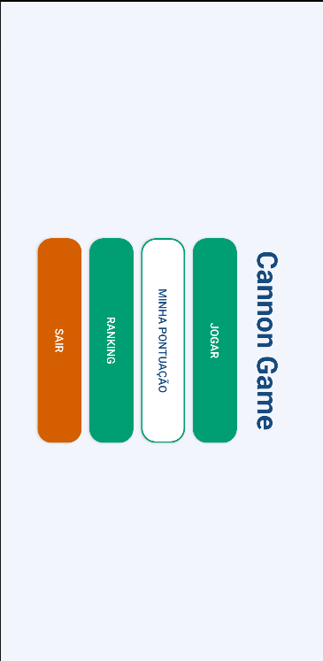
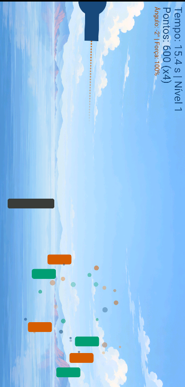
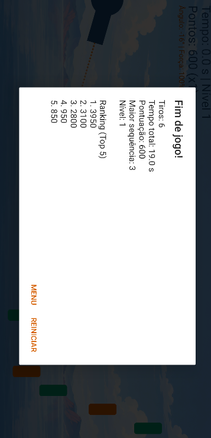

# Cannon Game

Jogo Android desenvolvido para a disciplina de **Programação III** da UEMG – Unidade Passos, com base no Capítulo 6 de *Android 6 for Programmers: An App-Driven Approach* (3ª edição).

## Integrantes

- Arthur Garlati
- Carolline Fernandes
- João Resende

## Requisitos

- Android Studio compatível com Android Gradle Plugin 8.13.2
- JDK 17
- Android SDK 34
- Gradle 8.13

O projeto requer conexão à internet na primeira sincronização para baixar o plugin e as dependências. O pacote fonte não contém `local.properties`; o Android Studio deve apontar para o Android SDK instalado na máquina.

## Como abrir e executar

1. Baixe ou clone este repositório.
2. No Android Studio, escolha **Open** e selecione a pasta `CannonGame` (a pasta que contém `settings.gradle`).
3. Configure o caminho do Android SDK quando solicitado e aguarde a sincronização do Gradle.
4. Selecione um emulador ou dispositivo Android com orientação paisagem.
5. Execute a configuração `app` pelo botão **Run**.

O aplicativo requer Android 5.0 (API 21) ou superior. Para gerar um APK de depuração, use **Build > Build APK(s)** no Android Studio.

## Como jogar

- **Toque simples:** mira o canhão no ponto tocado e atira.
- **Arraste para cima ou para baixo:** ajusta o ângulo do canhão.
- **Arraste para a direita ou para a esquerda:** ajusta a força do tiro.
- Acertar um alvo concede **3 segundos**; atingir o bloqueador desconta **2 segundos** e pontos.
- Destrua os nove alvos antes do tempo acabar para avançar de nível.

## Funcionalidades

### Requisitos do capítulo

- Game loop em thread dedicada com `SurfaceView` e `SurfaceHolder`.
- Desenho com `Canvas` e `Paint` e animação quadro a quadro.
- Sons de disparo e colisão com `SoundPool`.
- Colisões, nove alvos móveis e bloqueador.
- Modo imersivo, controles por toque e diálogos de fim de jogo.

### Recursos extras

- Multiplicador de pontuação por sequência de acertos, até x5.
- Dificuldade progressiva: alvos restantes aceleram e diminuem após acertos; os níveis aumentam a velocidade e reduzem o tamanho.
- Alvos com movimento vertical, senoidal e em zigue-zague.
- Efeito sonoro para disparos perdidos e trilha simples em volume baixo durante a partida.
- Gestos direcionais para ajustar mira e força.
- Efeitos de partículas ao acertar alvos.
- Ranking local Top 5 persistido com `SharedPreferences`.

### Identidade visual e acessibilidade

- O fundo ilustrado de céu e horizonte foi escolhido para dar mais sensação de imersão durante a partida, mantendo o cenário simples e com baixo contraste para não atrapalhar a leitura do HUD nem a visualização dos alvos.
- As barras e os botões usam verde-azulado (`#009E73`) e vermelhão (`#D55E00`). A combinação foi baseada na paleta Okabe-Ito, pensada para ajudar a diferenciar cores por pessoas com diferentes tipos de daltonismo.

## Capturas de tela

Adicione as imagens na pasta `docs/screenshots/` e mantenha estes nomes para que apareçam automaticamente no GitHub:

### Menu principal

Salve a captura como `docs/screenshots/menu.png`.



### Partida em andamento

Salve a captura como `docs/screenshots/partida.png`.



### Fim de jogo e ranking

Salve a captura como `docs/screenshots/ranking.png`.



## Estrutura do projeto

```text
app/src/main/java/br/edu/uemg/cannongame/
  MenuActivity.java        Menu principal
  MainActivity.java        Tela do jogo e modo imersivo
  CannonGameFragment.java  Fragmento e ciclo de vida
  CannonView.java          SurfaceView, game loop, regras e toque
  Cannon.java              Canhão
  Cannonball.java          Projétil
  GameElement.java         Elemento gráfico base
  Target.java              Alvos
  Blocker.java             Bloqueador
  Particle.java            Efeitos de partículas
  HighScoreManager.java    Ranking local
app/src/main/res/raw/      Efeitos sonoros e trilha
```
